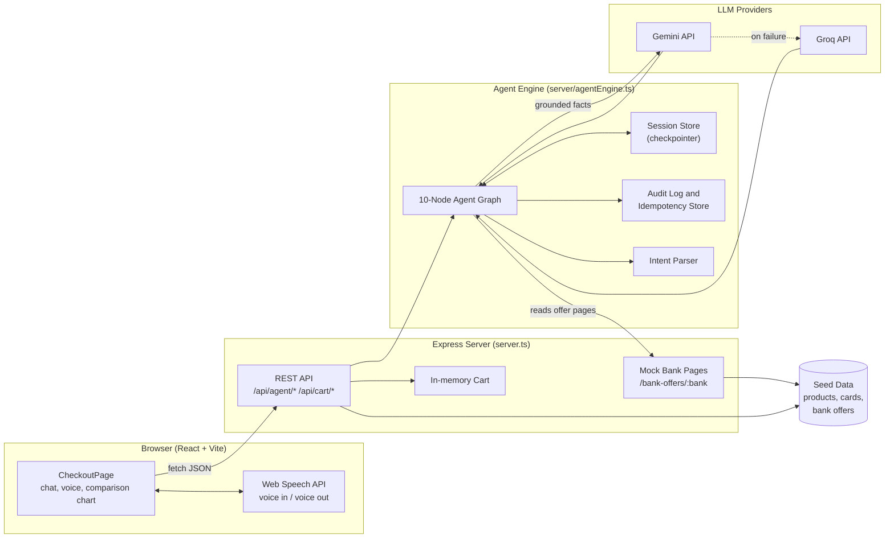
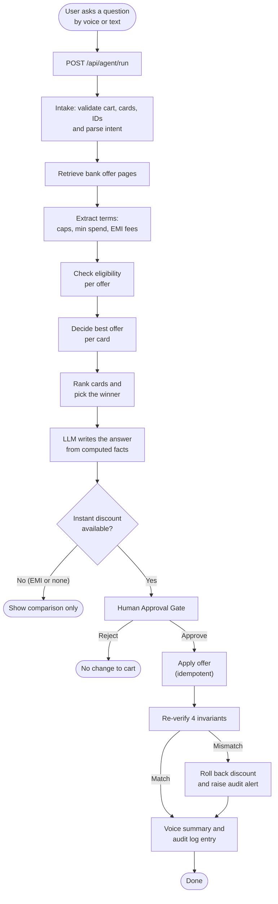

# 🛒 DealKart – Agentic Card Checkout Checker

> An AI-powered checkout assistant that finds which of your saved bank cards saves you the most on a cart, explains why, and applies the offer only after you approve it.


---

## 1. Overview

Indian e-commerce checkouts are full of bank offers: capped percentage discounts, flat cashbacks, "No-Cost" EMIs with hidden fees, debit-only deals and expired promotions. Comparing them by hand is slow and error-prone.

**DealKart** solves this with a 10-node agent graph (a LangGraph-style state machine). It reads your cart and saved cards, fetches bank offer pages, extracts the terms, checks eligibility, calculates the real final price for every card and ranks them. You can ask questions by **voice or text**, such as *"What if I use my ICICI card?"* or *"Compare EMI options"*, and get a live LLM answer.

Two design rules keep it trustworthy:

- **Numbers are never guessed.** All prices, caps and EMI costs come from deterministic code. The LLM only explains results that the engine already computed.
- **The user stays in control.** An offer is applied only after explicit approval, then re-verified against cart invariants, and rolled back if anything looks wrong.

> ⚠️ **Safe Evaluation Mode:** this project is for discount discovery only. No real payments, CVVs or bank credentials are stored or processed.

---

## 2. Features

| Area | What it does |
|---|---|
| 🤖 **Agent graph** | 10 specialised nodes from intake to voice summary, visible as a live stepper in the UI |
| 💬 **Live LLM chat** | Different question, different answer. Gemini first, Groq as a second option, with a deterministic fallback |
| 🎙️ **Voice assistant** | Speech input (Web Speech API, `en-IN`) and spoken replies (text-to-speech) |
| 💳 **Card comparison** | Ranked list and bar chart of the final payable price per saved card |
| 🧾 **Capped savings** | Percentage offers respect maximum caps and category limits |
| 🔍 **Hidden-fee detection** | "No-Cost" EMI processing fees plus 18% GST are added to the true cost |
| ✅ **Eligibility checks** | Expired offers, minimum spend, category limits, credit vs debit rules |
| 🙋 **Human approval gate** | Shows the proposed change and new total, then waits for Approve or Reject |
| 🔁 **Idempotent apply** | Retries cannot apply the same offer twice (idempotency key) |
| 🛡️ **Re-verification** | 4 audit invariants run after applying. A mismatch triggers an automatic rollback |
| 🧪 **Input validation** | Stable-ID checks, last-4-only card tokens, subtotal integrity and a checksum |
| 📜 **Audit log** | Every completed decision is recorded with reasoning and evidence source |
| 🧷 **Evidence drawer** | Per-card source URL, retrieval time and the raw bank terms used |
| 🧪 **Scenario test runner** | `/api/tests/run` checks winners, savings and tamper detection |

---

## 3. System Architecture



**Tech stack**

- **Frontend:** React, TypeScript, Tailwind CSS, lucide-react icons
- **Backend:** Node.js, Express, Vite middleware (dev) or static `dist/` (production)
- **AI:** Google Gemini (`@google/genai`), Groq (OpenAI-compatible API)
- **Voice:** browser Web Speech API (recognition and synthesis)

---

## 4. Workflow



---

## 5. Meet the Agents

```mermaid
flowchart LR
    N1["1. Intake Node<br/>validates inputs,<br/>parses intent"]
    N2["2. Offer Retriever<br/>fetches bank<br/>offer pages"]
    N3["3. Card Extractor<br/>parses terms<br/>and limits"]
    N4["4. Eligibility Agent<br/>expiry, min spend,<br/>category, card type"]
    N5["5. Best Offer Decider<br/>capped savings and<br/>true EMI cost"]
    N6["6. Summary Node<br/>ranks cards,<br/>builds proposal"]
    N7["7. Human Approval<br/>interrupt gate"]
    N8["8. Apply Offer<br/>idempotent,<br/>no payment"]
    N9["9. Re-Verify Node<br/>4 audit invariants,<br/>rollback"]
    N10["10. Respond Node<br/>voice summary,<br/>audit log"]

    N1 --> N2 --> N3 --> N4 --> N5 --> N6 --> N7 --> N8 --> N9 --> N10
```



| # | Agent | Responsibility |
|---|---|---|
| 1 | **Intake Node** | Validates cart items, owned cards and subtotal integrity, creates a checksum and turns the question into an intent (`best_deal`, `bank_focus`, `emi_compare`, `no_emi`) |
| 2 | **Offer Retriever** | Loads each bank's offer page and records the source URL and retrieval time |
| 3 | **Card Extractor** | Converts page terms into structured offers and flags uncertain ones, such as cashback credited later or reward points |
| 4 | **Eligibility Agent** | Rejects expired offers, carts below minimum spend and offers whose category isn't in the cart, then computes capped discounts and EMI costs |
| 5 | **Best Offer Decider** | Chooses each card's cheapest eligible offer and applies the "no EMI" or "compare EMI" preference |
| 6 | **Summary Node** | Sorts cards by final price, picks the winner for the intent and builds the approval proposal (instant discounts only) |
| 7 | **Human Approval Node** | Pauses the graph until the user approves, rejects or switches card |
| 8 | **Apply Offer Node** | Applies the discount once, guarded by an idempotency key. It never takes payment |
| 9 | **Re-Verify Node** | Runs 4 invariants (total match, discount integrity, cart balance equation, minimum spend) and rolls back on mismatch |
| 10 | **Respond Node** | Produces the spoken and chat summary and writes the audit log entry |

---

## 6. Project Structure

```
dealkart---card-offer/
├── server.ts                  # Express app: REST API, mock bank pages, Vite/static mount
├── server/
│   └── agentEngine.ts         # 10-node agent graph, intent parser, LLM helpers, audit log
├── src/
│   ├── components/
│   │   └── CheckoutPage.tsx   # Chat, voice, approval gate, comparison chart, stepper
│   ├── data/
│   │   ├── seedData.ts        # Products, saved cards, test scenarios
│   │   └── mockBankData.ts    # Mock bank offer HTML pages
│   └── types.ts               # Shared TypeScript types
├── .env.example               # Names of required environment variables (no secrets)
├── .gitignore
├── package.json
└── README.md
```

---

## 7. How It Works

1. **Ask.** You type or speak a question. The page also runs a silent evaluation on load, which skips the LLM, so the comparison chart fills immediately.
2. **Understand.** The intake node validates all inputs and parses your intent, for example a bank focus such as "ICICI" or an EMI preference.
3. **Gather.** The engine reads the bank offer pages and extracts structured offers with their caps, minimum spends, categories and fees.
4. **Calculate.** Each offer is checked for eligibility and priced. Percentage offers are capped, and EMI offers add interest, processing fee and 18% GST.
5. **Rank.** Cards are sorted by the lowest final payable amount, and the winner is chosen according to your question.
6. **Explain.** A compact JSON of the computed facts is sent to Gemini (or Groq if Gemini fails) together with the recent chat. The model writes a short answer and is told to use only those numbers. If both fail, a deterministic message is shown.
7. **Approve.** For instant discounts, the approval card shows the destination, the change and the new total. EMI plans are comparison-only and are never applied as discounts.
8. **Apply and verify.** After approval the offer is applied once, then re-verified against four invariants. A mismatch rolls the discount back and shows an audit alert.
9. **Record.** The decision, reasoning and evidence source are stored in the audit log.

### Run locally

```bash
git clone https://github.com/Uttam15n/DealKart-Agentic-Card-Checkout-Checker.git
cd DealKart-Agentic-Card-Checkout-Checker
npm install
```

Open `http://localhost:3000`

### Key endpoints

| Method | Path | Purpose |
|---|---|---|
| POST | `/api/agent/run` | Start an evaluation and get the live LLM answer |
| POST | `/api/agent/approve` | Approve, apply and re-verify the offer |
| POST | `/api/agent/reject` | Reject the proposal |
| GET | `/api/audit-logs` | Read the audit trail |
| POST | `/api/tests/run` | Run scenario tests |
| GET | `/bank-offers/:bank` | Mock bank offer pages |
| GET | `/health` | Status and key presence |

## 8. Screenshots

| Home Page | Bank offer and Save Cards |
|---|---|
| |  |

| Test Cases | CheckOut Page |
|---|---|
|  | |

| LangGraph Voice Assistant | Best offer AI Solution |
|---|---|
|  |  |

---

## 9. Author

**Uttam**

- GitHub: [@Uttam15n](https://github.com/Uttam15n)
- Project: https://dealkart-agentic-card-checkout-checker.onrender.com/

